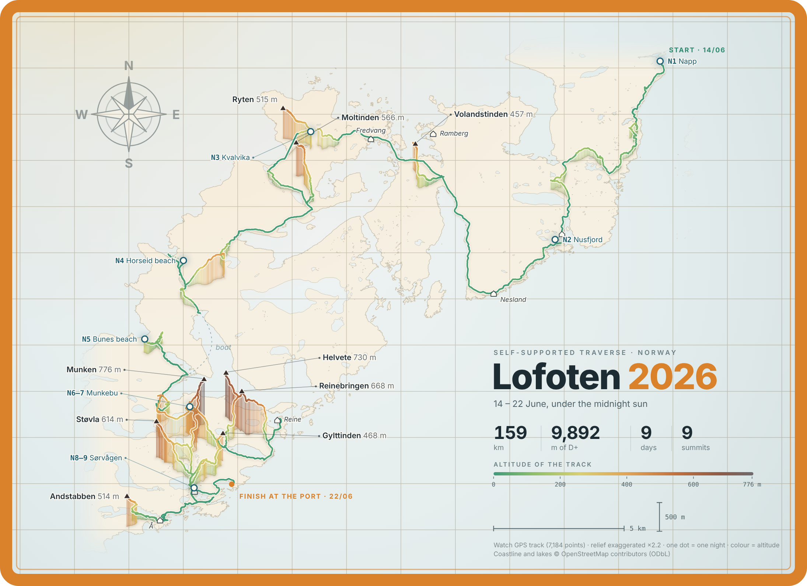

# Lofoten 2026 — a traverse read as a risk analysis


Nine days alone and self-supported in the Lofoten Islands (Norway), from 14 to 22 June 2026, under the midnight sun: **159 km, 9,892 m of elevation gain, 25 outings**, with a bivouac pack on my back, or running light to the summits.

I planned this trek, walked it, then analysed its data with the tools of financial risk management.

> **Research question** — Alone, self-supported, under the midnight sun: where did the risk really concentrate during the traverse, and had the plan anticipated it?

## See the project

| | |
|---|---|
| **3D map** | [English](https://baptistearibaud88-collab.github.io/Lofoten-risk/map.html) · [Français](https://baptistearibaud88-collab.github.io/Lofoten-risk/) |
| **Risk analysis report** | [English](https://baptistearibaud88-collab.github.io/Lofoten-risk/risk.html) · [Français](https://baptistearibaud88-collab.github.io/Lofoten-risk/risque.html) |
| **The film** | [Watch the film (2 min 13)](https://baptistearibaud88-collab.github.io/Lofoten-risk/video/lofoten_norvege_1080p.mp4) — shot on a GoPro HERO13 Black |

## The 3D map



An interactive map that brings together all the data of the trek, sorted by night, by outing and in the starting gear list, with the notes and the story of the traverse.

Opposite, the traverse seen from above: the watch's GPS track, in relief and coloured by altitude, with the nine nights, the nine summits and the villages, from Napp to the harbour of Moskenes. The dotted line marks the only boat crossing, from Kirkefjord to Vindstad.

<br clear="left">

## The report in three acts

| Act | Part | In one sentence |
|---|---|---|
| **1 · Measure** | 01 Relief and grading | 25 outings as candles, terrain graded on the Norwegian scale (DNT): 52% of the distance on demanding or expert terrain. |
| | 02 Deviations and time lost | Each 250 m segment compared with an expected pace (recalibrated Tobler): deviations almost normal one by one, but they come in streaks. |
| | 03 Independent summits, shared weather | Specific risk (the terrain of one massif) diversified, systematic risk (the rain) hitting everything at once. |
| **2 · Explain** | 04 Sensitivities and fatigue | Factor regression: pack +41%, steep descent +22%, +15% per terrain level; fatigue tracked by night-time HRV. |
| | 05 Weather | 2026 against 30 summers (ERA5): six dry days, then a rare rain episode. |
| | 06 The Greeks | The measurements read as the sensitivities of an option: delta, gamma, vega, theta, rho. |
| **3 · Steer** | 07 Monte Carlo and the reserve day | 5,000 traverses simulated in 1,200 real summers; value at risk, backtest, stress test; the reserve day valued with Black-Scholes. |
| | 08 Plan versus actual | The plan as a benchmark: 7 km out of 10 of the route followed, but the effort held within 2%. |
| | 09 Luck or decision | Rain as volatility, the reserve day as the only real option. |
| | 10 Conclusion | What the week showed, and the rules for the next traverse. |


## Data and methods

- **Data**: GPS watch (7,184 points, heart rate, HRV and sleep over 9 nights), ERA5 weather (Copernicus, 30 summers 1996–2025), grades of the outings (DNT and hiking guides), route planned before leaving (Strava).
- **Processing**: traverse cut into 604 segments of 250 m, one wrong segment left out (faulty GPS altitude); each segment linked to its weather, the previous night, its grade and whether the pack was carried.
- **Methods**: recalibrated Tobler's rule, normality and runs tests, factor regression (least squares), block Monte Carlo simulation with the climate drawn from 1,200 real windows, value at risk and expected shortfall, backtest (Kupiec, Basel), stress test, Black-Scholes / Black 1976 on a call spread, performance attribution (Brinson), real options (Myers).

Each method, its limits and its sources are detailed in the report (the "?" buttons and the "Methods and sources" part).

## Repository layout

```
index.html            3D map, French (home page)
risque.html           risk analysis report, French
map.html, risk.html   the same two pages in English (generated by outils/anglais.js)
css/                  page styles
js/                   page code (app.js: map; risque.js: report; js/en/: English versions)
data/                 data loaded by the pages (data.js, risque_*.js, ressentis_episodes.js; data/en/: English texts)
donnees/              raw data: planned route (plan.gpx), ERA5 rain 1996–2025
outils/               computation scripts (Node.js) that produce data/risque_*.js
outils/anglais/       translation dictionaries for the English pages
outils/apercu/        screenshots and word counts (Python + Playwright), for proofreading
photos/               photos of the traverse (and thumbnails)
video/                the film (1080p, H.264) and its thumbnails
docs/                 README images (French and English)
```

## Reproducing the calculations

Every figure in the report is computed by the scripts in `outils/`, from the data in `donnees/` and `data/`. The simulations use a fixed seed: rerunning the scripts gives exactly the same results.

<details>
<summary>The commands, in order</summary>

`data/risque_data.js` (base analysis) and `data/data.js` (track and story) are produced upstream, outside this repository; the other files in `data/` derive from them. From the root:

```bash
node outils/segmentation_terrain.js   # grading by section (01)            → data/risque_sections.js
node outils/distribution.js           # deviations from expected pace (02) → data/risque_dist.js
node outils/episodes_allure.js        # slow episodes and massifs (02–03)  → data/risque_episodes.js
node outils/bougies_sorties.js        # candles per outing (01)            → data/risque_bougies.js
node outils/meteo_series.js           # rain over 1,200 windows (05)       → data/risque_meteo.js
node outils/indice_danger.js          # irregularity and slope per outing  → data/risque_indice.js
node outils/sensibilites.js           # regression and correlations (04)   → data/risque_sens.js
node outils/plan_reel.js              # plan versus actual (08)            → data/risque_plan.js
node outils/frequence_cardiaque.js    # the heart by terrain (04, 06)      → data/risque_fc.js
node outils/carte_reel.js             # route map (README)                 → docs/carte_reel.svg
node outils/monte_carlo.js            # simulation, backtest, stress (07)  → data/risque_mc.js
node outils/conclusion_acte2.js       # the Greeks (06)                    → data/risque_acte2.js
node outils/marge_option.js           # reserve day, Black-Scholes (07)    → data/risque_marge.js
node outils/chance_decision.js        # volatility and option (09)         → data/risque_cd.js
node outils/carte_resume.js           # "Risk analysis" card on the map    → data/risque_carte.js
node outils/anglais.js                # English version of the pages       → map.html, risk.html, js/en/, data/en/
```

The English version is regenerated after any change to the French pages; its translations live in `outils/anglais/`. `data/ressentis_episodes.js` is filled in by hand (cause of each slow episode). After a change, bump the file's `?v=` number in the page to avoid the browser cache. To proofread locally: `python3 outils/apercu/captures.py s1 s7` (`--mobile` for phone width) and `python3 outils/apercu/textes.py`.

</details>

## Sources

Weather: ERA5 (Copernicus / Open-Meteo). Grading: DNT (Den Norske Turistforening), 68north, Horizon Rando, Hunting for Bliss. Base maps: Mapzen / AWS Terrain Tiles relief, Esri World Imagery, OpenTopoMap topo (© OpenStreetMap, CC-BY-SA), rendered with MapLibre GL JS. Route map: coastline and lakes © OpenStreetMap contributors (ODbL), overpass-turbo exports.

<sub>[Version française](README.fr.md)</sub>
