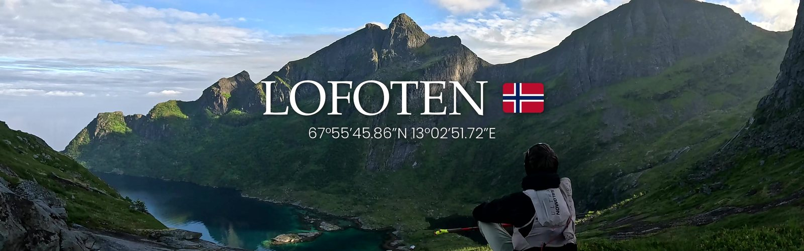

# Lofoten 2026 — une traversée lue comme une analyse de risque



Neuf jours seul et en autonomie dans les îles Lofoten (Norvège), du 14 au 22 juin 2026, sous le soleil de minuit : **159 km, 9 892 m de dénivelé positif, 25 sorties**, sac de bivouac sur le dos ou en trail léger pour les sommets.

J'ai organisé ce trek, je l'ai marché, puis j'en ai analysé les données avec les outils de la gestion des risques en finance.

> **Problématique** — Seul, en autonomie, sous le soleil de minuit : où le risque s'est-il réellement concentré pendant la traversée, et le plan l'avait-il anticipé ?

## Voir le projet

| | |
|---|---|
| **Carte 3D** | [baptistearibaud88-collab.github.io/Lofoten-risk](https://baptistearibaud88-collab.github.io/Lofoten-risk/) |
| **Rapport d'analyse de risque** | [baptistearibaud88-collab.github.io/Lofoten-risk/risque.html](https://baptistearibaud88-collab.github.io/Lofoten-risk/risque.html) |
| **Le film** | [Regarder le film (2 min 13)](https://baptistearibaud88-collab.github.io/Lofoten-risk/video/lofoten_norvege_1080p.mp4) — tournage GoPro HERO13 Black, montage personnel |

## La carte 3D

Une carte interactive qui rassemble toutes les données du trek, classées par nuit, par sortie et dans l'inventaire de départ, avec les annotations et le récit de la traversée.

## Le rapport en trois actes

| Acte | Partie | En une phrase |
|---|---|---|
| **1 · Mesurer** | 01 Relief et cotation | 25 sorties en bougies, terrain coté sur l'échelle norvégienne (DNT) : 52 % de la distance en terrain exigeant ou expert. |
| | 02 Écarts et temps perdu | Chaque tronçon de 250 m comparé à une allure attendue (Tobler recalé) : écarts presque normaux un par un, mais qui arrivent en série. |
| | 03 Sommets indépendants, météo commune | Risque spécifique (le terrain d'un massif) diversifié, risque systématique (la pluie) qui touche tout à la fois. |
| **2 · Expliquer** | 04 Sensibilités et fatigue | Régression à facteurs : sac +41 %, descente raide +22 %, +15 % par niveau de terrain ; fatigue suivie par la VFC nocturne. |
| | 05 Météo | 2026 face à 30 étés (ERA5) : six jours secs, puis un épisode de pluie rare. |
| | 06 Les grecs | Les mesures relues comme les sensibilités d'une option : delta, gamma, vega, thêta, rho. |
| **3 · Piloter** | 07 Monte Carlo et jour de marge | 5 000 traversées simulées dans 1 200 étés réels ; valeur à risque, contrôle a posteriori, test de résistance ; le jour de marge évalué avec Black-Scholes. |
| | 08 Plan contre réel | Le plan comme indice de référence : 7 km sur 10 du tracé suivis, mais l'effort tenu à 2 % près. |
| | 09 Chance ou décision | La pluie comme volatilité, le jour de marge comme seule option réelle. |
| | 10 Conclusion | Ce que la semaine a montré, et les règles pour la prochaine traversée. |


## Les données et les méthodes

- **Données** : montre GPS (7 184 points, fréquence cardiaque, VFC et sommeil de 9 nuits), météo ERA5 (Copernicus, 30 étés 1996–2025), cotes des sorties (DNT et guides), plan tracé avant le départ (Strava).
- **Traitement** : traversée découpée en 604 tronçons de 250 m, un tronçon faux écarté (altitude GPS erronée) ; chaque tronçon rattaché à sa météo, à la nuit précédente, à sa cote et au port ou non du sac.
- **Méthodes** : loi de Tobler recalée, tests de normalité et de séries, régression à facteurs (moindres carrés), simulation de Monte Carlo par blocs avec climat tiré dans 1 200 fenêtres réelles, valeur à risque et expected shortfall, contrôle a posteriori (Kupiec, Bâle), test de résistance, Black-Scholes / Black 1976 sur un call spread, attribution de performance (Brinson), options réelles (Myers).

Le détail de chaque méthode, ses limites et ses sources sont dans le rapport (boutons « ? » et partie « Méthodes et sources »).

## Organisation du dépôt

```
index.html            carte 3D (page d'accueil)
risque.html           rapport d'analyse de risque
css/                  styles des deux pages
js/                   code des deux pages (app.js : carte ; risque.js : rapport)
data/                 données chargées par les pages (data.js, risque_*.js, ressentis_episodes.js)
donnees/              données brutes : plan tracé (plan.gpx), pluie ERA5 1996–2025
outils/               scripts de calcul (Node.js) qui produisent data/risque_*.js
outils/apercu/        captures d'écran et comptage des mots (Python + Playwright), pour relire
photos/               photos de la traversée (et miniatures)
video/                le film (1080p, H.264) et ses miniatures
docs/                 image du README
```

## Reproduire les calculs

Tous les chiffres du rapport sont calculés par les scripts du dossier `outils/`, à partir des données de `donnees/` et `data/`. Les simulations utilisent une graine fixe : relancer les scripts redonne exactement les mêmes résultats.

<details>
<summary>Les commandes, dans l'ordre</summary>

`data/risque_data.js` (analyse de base) et `data/data.js` (trace et récit) sont produits en amont, hors de ce dépôt ; les autres fichiers de `data/` en sont dérivés. Depuis la racine :

```bash
node outils/segmentation_terrain.js   # cotation par section (01)          → data/risque_sections.js
node outils/distribution.js           # écarts à l'allure attendue (02)    → data/risque_dist.js
node outils/episodes_allure.js        # épisodes lents et massifs (02–03)  → data/risque_episodes.js
node outils/plan_reel.js              # plan contre réel (08)              → data/risque_plan.js
node outils/bougies_sorties.js        # bougies par sortie (01)            → data/risque_bougies.js
node outils/meteo_series.js           # pluie sur 1 200 fenêtres (05)      → data/risque_meteo.js
node outils/indice_danger.js          # rangs d'exposition des sorties     → data/risque_indice.js
node outils/sensibilites.js           # régression et corrélations (04)    → data/risque_sens.js
node outils/monte_carlo.js            # simulation, contrôle, résistance (07) → data/risque_mc.js
node outils/conclusion_acte2.js       # les grecs (06)                     → data/risque_acte2.js
node outils/marge_option.js           # jour de marge, Black-Scholes (07)  → data/risque_marge.js
node outils/chance_decision.js        # volatilité et option (09)          → data/risque_cd.js
node outils/carte_resume.js           # encart « Analyse de risque » de la carte → data/risque_carte.js
```

`data/ressentis_episodes.js` se remplit à la main (cause de chaque épisode lent). Après une modification, monter le numéro `?v=` du fichier dans la page pour éviter le cache du navigateur. Pour relire en local : `python3 outils/apercu/captures.py s1 s7` (`--mobile` pour le téléphone) et `python3 outils/apercu/textes.py`.

</details>

## Sources

Météo : ERA5 (Copernicus / Open-Meteo). Cotation : DNT (Den Norske Turistforening), 68north, Horizon Rando, Hunting for Bliss. Fonds de carte : relief Mapzen / AWS Terrain Tiles, imagerie Esri World Imagery, topo OpenTopoMap (© OpenStreetMap, CC-BY-SA), rendu MapLibre GL JS.
